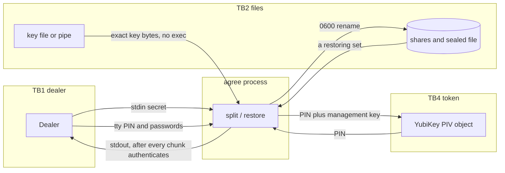

# Threat Model: agree

| Field | Value |
| --- | --- |
| Mode / depth | bootstrap / standard |
| Provenance | code |
| Target / ref | working tree on `71dcdb3`, 2026-11-10 |
| Cloud / tenancy | none. Local ceremony CLI. Not a SaaS. |
| Status | approved |
| Authors / reviewers | Facilitated from the repository. Owner sign-off: Alexander Weber, pending. |
| Date | 2026-11-10 |
| Parent model | none |
| Skill | saas-threat-model@2, adapted. Packs that assume a public-cloud tenant are N/A. |

Safety: static review of this repository. No live attack, no fuzzing of a card, no secret values recorded here.

## 0. Executive summary

`agree` 1.0.0 splits an arbitrary-length secret so a quorum of shares can restore it. The secret is encrypted under a data key. One quorum splits that key with Shamir. Further quorums split pads that XOR to the key. A weight is that many Shamir points in one share file. Shares may sit on files, `device:` nodes, or YubiKey PIV objects. Split reads stdin. Restore writes stdout.

This is not a multi-tenant service. The trust boundary is the dealer machine and the people who hold shares. The tool cannot make an untrusted dealer safe.

Top risks:

| ID | Risk | One line |
| --- | --- | --- |
| T-001 | High | The process that runs `split` or `restore` sees the whole secret. |
| T-002 | High | A retained copy of `--key-file` opens the sealed secret with no shares. |
| T-003 | High | The Shamir claim depends on unaudited `shamirs` 0.7.0. |
| T-004 | Medium | A YubiKey or `device:` write cannot be rolled back after a later failure. |
| T-005 | Medium | Core-dump disable is best-effort. `mlock` failure now refuses to run. Swap of an unlocked data key is closed; a crash dump can still keep key bytes. |
| T-006 | Low | Authentication failure used to be able to emit a plaintext prefix. Fixed in this tree: stdout is written only after every chunk authenticates. |
| T-007 | Medium | No independent cryptographic audit. |

Decisions: Alexander Weber accepted T-001 through T-008 on 2026-11-10. Review by 2027-11-10. The ceremony checklists in `docs/CEREMONY.md` (3 of 5) and `docs/CEREMONY-POLICY.md` (two quorums, weights not all 1) are the controls for the risks the binary cannot close. Do not mix the two pages.

Residual headline: a careful 3-of-5 ceremony on a watched air-gapped machine is what the tool is for. It is not a substitute for an audited HSM, and it does not keep the quorum after restore.

## 1. System description

### 1.1 Purpose and business context

Break-glass storage of a secret, typically a signing key. Journeys:

1. Dealer splits stdin into `n` shares. The default policy is threshold `t`, every weight 1. Optional weights and further quorums are the same split. Optional external data key.
2. Custodians store shares apart from each other.
3. A set that meets every quorum restores the original bytes to stdout. A set that misses one does not.
4. `agree devices` lists hardware this build can open.

There is no network service, no account, and no second use of the secret after restore.

### 1.2 In scope / out of scope

In scope: the `agree` binary, format v1, file / `device:` / `yubikey:` destinations, `--key-file`, passwords, weights, quorums, and the dealer machine while the process runs.

Out of scope: cloud control planes, tenant isolation, CSP physical security, Okta/FIDO2 logins, Git signing, and whatever the restored signing key is used for afterwards. N/A — this product does not run there.

### 1.3 Actors and trust levels

| ID | Actor | Type | Trust | AuthN | Notes |
| --- | --- | --- | --- | --- | --- |
| A-1 | Dealer | human | high for the hour of the ceremony | physical presence | Sees the secret. Required by the design. |
| A-2 | Custodian | human | holds one share | share possession, optional password, optional YubiKey PIN | Must not hold a set that meets every quorum alone. |
| A-3 | Hostile custodian | adversarial | a set that misses a quorum | same | Goal: open the secret without a quorum. |
| A-4 | Thief of shares | adversarial | stolen files or tokens | none | Same goal as A-3 if they meet every quorum. |
| A-5 | Operator of the dealer machine | adversarial or careless | the process | local user | Malware, swap, core dump, shell history. |
| A-6 | Supply chain | adversarial | crate author or build | none | `shamirs`, `chacha20poly1305`, `yubikey`, `aes`. |

Anonymous internet, tenant admin, support impersonation, CI cloud admin, and IdP attackers do not have a path into this binary. Dropped: no network listener.

### 1.4 Assets

| Asset | C | I | A | Store | Lawful accessor |
| --- | --- | --- | --- | --- | --- |
| Original secret | H | H | M | stdin, process memory, stdout | dealer at split; quorum at restore |
| Data key | H | H | M | process memory, then only as Shamir shares | quorum |
| Share body | H | H | M | file 0600, device node, PIV object | that custodian |
| Sealed ciphertext | L | H | H | file, device, or PIV object | anyone; useless without the key |
| Share password | H | H | L | terminal or `--password-stdin` | that custodian |
| PIV PIN and management key | H | H | M | terminal, or argv if `--management-key` | dealer |
| Group id, policy, key length | L | M | L | cleartext header | anyone with the file |

Cross-tenant rule: N/A. One ceremony, one group id. A share from another group is rejected.

### 1.5 Data classification

| Data | Class | Residency | Retention | Crypto | Cross-tenant | Subprocessors |
| --- | --- | --- | --- | --- | --- | --- |
| Secret | Restricted | the ceremony machine, then the shares | until the operator wipes it | XChaCha20-Poly1305, layered | N/A | none in the tool |
| Data key | Restricted | memory, then Shamir | wiped on drop; not written in the clear | Shamir over GF(256) | N/A | `shamirs` crate, in process |
| PIN / management key | Restricted | memory, argv if flagged | process lifetime | none at rest in the tool | N/A | none |
| Sealed file | Internal | wherever the operator stores it | until rotation | ciphertext | N/A | none |

### 1.6 Entry and exit points

| Direction | Surface | Data |
| --- | --- | --- |
| In | stdin | secret on split; PIN and password lines on restore if those flags are set |
| In | `--key-file` | exact `--key-bytes` of key material. Not executed. |
| In | `/dev/tty` | passwords, PIN, management key |
| In | `--management-key` | 48 hex characters on the command line |
| In | `--share`, `--sealed` | existing shares and sealed bytes |
| Out | stdout | restored secret only. Refused if it is a terminal. |
| Out | stderr | status, warnings. `--debug` also prints PIN and management key. |
| Out | share and sealed destinations | format v1 bytes |
| Out | temp files | staged ciphertext, and plaintext only until authentication finishes |

No HTTPS, webhooks, queues, or admin API.

### 1.7 Trust boundaries

| Boundary | What crosses | Control | Failure |
| --- | --- | --- | --- |
| TB1 Operator ↔ process | stdin, tty, argv | local user is the dealer | Fail open to that user. That is the ceremony. |
| TB2 Process ↔ filesystem | shares, sealed file, key file | `0600` create, no overwrite without `--force` | Fail closed on existence and permission errors. |
| TB3 Process ↔ device node | raw bytes | `--force` required, refuse a terminal | Fail closed without `--force`. No rollback after a partial write. |
| TB4 Process ↔ YubiKey | PIV object, PIN, management key | PIN to read, management key to write, object id allow-list | Fail closed on auth. A successful write cannot be unwritten. |
| TB5 A set that misses a quorum ↔ secret | nothing, if Shamir, the pad XOR, and AEAD hold | quorum check, then Poly1305 | Fail closed. Stdout untouched. |
| TB6 This binary ↔ another `agree` | files | format revision byte | Fail closed. No old reader. |

Internet ↔ edge, tenant ↔ tenant, IdP, CI ↔ prod, and CSP management plane: N/A. No such boundary exists.

### 1.8 Architecture overview

One binary. `main` parses arguments and prompts. `engine` streams the secret, splits the key, and restores. `crypto` does layered XChaCha20-Poly1305 and Argon2id share wrap. `format` revision is 1. `store` publishes files by rename. `hardware` talks PC/SC. `devices` lists kinds. The default build links PC/SC. `--no-default-features` rejects `yubikey:` locations.

### 1.9 Data flow diagrams



L2 restore: read shares, reject a set that misses a quorum, unwrap passwords, stage the sealed file, check the commitment, recover each pad, XOR the pads, decrypt every chunk to a `0600` temp file, and only then copy to stdout. One quorum recovers the data key directly. There is no second pad.

### 1.10 Interaction tuples

| ID | Tuple | Boundary | Assets |
| --- | --- | --- | --- |
| TU-1 | Dealer --stdin--> split | TB1 | secret |
| TU-2 | `--key-file` --bytes--> split | TB2 | data key |
| TU-3 | split --Shamir share--> file or YubiKey | TB2, TB4 | share |
| TU-4 | split --ciphertext--> sealed destination | TB2, TB3, TB4 | sealed file |
| TU-5 | a restoring set --recover pads, XOR--> data key | TB5 | data key |
| TU-6 | sealed file + key --decrypt--> stdout | TB5 | secret |
| TU-7 | argv `--management-key` --> process list | TB1 | management key |

### 1.11 Tenancy and isolation model

N/A as SaaS tenancy. Isolation is the policy (weights and quorums) plus the group id and commitment. A share from another split does not open this sealed file. There is no row filter to get wrong. A weight is points in the file, not a label checked after interpolation.

### 1.12 Identity and access model

No user accounts. Access to a share is possession. A password is a local wrap, not a second approval system. A YubiKey PIN is the card's check, not an `agree` account. `--force` is the only overwrite grant. Empty management-key prompt uses the factory key and warns.

### 1.13 Dependencies and shared responsibility

| Dependency | Data | Failure | Compromise impact | Owner |
| --- | --- | --- | --- | --- |
| OS CSPRNG via `getrandom` | data key, nonces, group id | split refuses if the RNG fails | predictable key | OS |
| `shamirs` 0.7.0, pinned | data key or pad bytes | wrong field arithmetic | fewer points than that pad's threshold reconstruct the pad | crate author, unaudited |
| `chacha20poly1305` | secret chunks, share wrap | auth failure | fail closed | RustCrypto |
| `argon2` | share passwords | slow unwrap | local cost, not a remote DoS | crate |
| `yubikey` 0.8.0 feature `untested` | PIV reads and writes | card error | fail closed; upstream marks those APIs untested | crate, plus `piv_aes` in this repo |
| PC/SC | card I/O | missing daemon | YubiKey commands fail | operator |
| Dealer OS | all of the above in memory | swap, dump, malware | full secret | operator |

### 1.14 Security-relevant design and code properties

- Memory-safe Rust. `unsafe` is limited to `mlock`, core-dump rlimit, and terminal echo off.
- Secret and data key buffers are zeroized on drop. `DataKey` and `Password` redact `Debug`.
- Restore refuses a terminal stdout.
- Commitment is checked before decryption. Decryption of every chunk finishes before stdout is written.
- Share passwords are not read from the secret's stdin.
- `--key-file` is not executed and is not a `device:` or `yubikey:` location.
- Key length is a multiple of 32, from 32 to 1024, checked again on restore.
- File outputs are created `0600` and published by rename.
- Format revision 1 is the only revision this binary reads.

### 1.15 Assumptions

| # | Assumption | State |
| --- | --- | --- |
| A1 | The dealer machine is watched and wiped after the ceremony. | OWNER_CLAIM. The tool cannot check it. |
| A2 | Custodians do not pool a set that meets every quorum outside a restore. A weight-2 file is two points; after it is unwrapped those points can be peeled apart. That is the same class of failure as copying a share. | OWNER_CLAIM. |
| A3 | `shamirs` 0.7.0 implements GF(256) Shamir correctly. | UNVERIFIED by an independent audit. Tests in this repo check the quorum matrix against that crate. |
| A4 | XChaCha20-Poly1305 in `chacha20poly1305` 0.10.1 is correct. | UNVERIFIED by an audit of this product. The construction uses a distinct key per layer and a nonce of random prefix plus chunk counter. |
| A5 | A pipe passed as `--key-file` is not retained by the generator. | OWNER_CLAIM. |
| A6 | Factory PIV PIN and management key are changed before a production ceremony. | OWNER_CLAIM. The tool warns if the prompt is left empty. |

### 1.16 Compliance / contractual drivers

None in the repository. Impact of a failed ceremony is loss or disclosure of the secret the operator chose to split. That is Restricted data by the operator's own classification, not a regulation this tool implements.

### 1.17 Existing controls inventory

| ID | Kind | Description | Coverage | Evidence |
| --- | --- | --- | --- | --- |
| C-1 | prevent | Quorum check before decrypt | every restore | engine tests, CLI quorum test |
| C-2 | prevent | Poly1305 per chunk, layer number in AAD | every chunk | crypto unit test |
| C-3 | prevent | SHA-256 commitment of sealed bytes in every share | every restore | engine tamper tests |
| C-4 | prevent | Stdout refused when it is a terminal | restore | CLI |
| C-5 | prevent | `0600` and rename publish | file shares | store tests, CLI mode check |
| C-6 | prevent | `--force` required for overwrite and `device:` | writes | CLI |
| C-7 | prevent | Reserved PIV objects refused without `--force` | YubiKey writes | hardware tests, no card opened |
| C-8 | prevent | Key file length checked before shares are written | split | CLI and crypto tests |
| C-9 | prevent | Plaintext held off stdout until every chunk authenticates | restore | `authentication_failure_does_not_emit_a_prefix` |
| C-10 | prevent | Data key `mlock`ed or the command refuses. Core dumps disabled when the OS allows | process | `mlock` fail-closed. Core-dump failure warns and continues. |
| C-11 | respond | File shares already published are removed if a later file share fails | split | CLI rollback test |

## 2. Threat analysis

### 2.1 Adversary set and objectives

A-3 and A-4 want the secret with a set that misses a quorum. A-5 wants the secret from the dealer machine during or after the ceremony. A-6 wants a backdoor in a dependency. Nobody is attacking a remote API, because there is not one.

### 2.2 Methodology notes

STRIDE on TU-1 through TU-7, then the process and the share store. SaaS packs are addressed below and marked N/A where the surface does not exist. Evidence is the code and tests in this tree, not a pentest.

### 2.3 Threat catalog

```
ID: T-001
Title: Dealer, or malware on the dealer machine, reads the secret during split or restore
STRIDE: [I]
Packs: [H]
Actor: A-1, A-5
Surface: TU-1, TU-6
Assets: secret, data key
Preconditions: code runs on a machine the attacker can read
Attack path:
  1. Operator runs split with the secret on stdin.
  2. The process holds the secret and the data key in memory until the shares are written.
  3. A debugger, a malicious library, or a copied terminal scrollback keeps the bytes.
Impact: { c: H, i: H, a: L, tenancy_breach: N, privacy: H }
Impact narrative: The quorum never existed for that copy. One person has the secret.
Blast radius: the secret that was split
Likelihood: H
Likelihood rationale: This is how the tool works. C-10 reduces crash dumps only.
Risk: High
Evidence: engine streams the secret in-process; README states the dealer is trusted
Existing controls: C-10
Mitigations: M-001
Detection: none in the tool
Disposition: accept
Owner: Alexander Weber
Status: accepted
Review_by: 2027-11-10
Accepted: 2026-11-10 by Alexander Weber
Refs: ceremony is the control, not a claim the binary can make
```

```
ID: T-002
Title: Holder of the external data key opens the sealed secret without any share
STRIDE: [I, E]
Packs: [K]
Actor: A-5
Surface: TU-2, TU-4
Assets: data key, secret
Preconditions: --key-file was a retained file, or the generator kept the bytes
Attack path:
  1. Operator passes --key-file.
  2. The same bytes remain on disk or in the generator's history.
  3. That copy is the data key. Shamir is optional.
Impact: { c: H, i: H, a: L, tenancy_breach: N, privacy: H }
Impact narrative: The shares are no longer the quorum.
Blast radius: that sealed secret
Likelihood: M
Likelihood rationale: A pipe does not leave a file. A path the operator keeps does. The tool does not delete the source, and a wipe would be a lie on an SSD.
Risk: High
Evidence: read_key_file reads and does not unlink
Existing controls: C-8
Mitigations: M-002
Detection: none
Disposition: accept
Owner: ceremony operator
Status: accepted
Review_by: 2027-11-10
Accepted: 2026-11-10 by Alexander Weber
```

```
ID: T-003
Title: A flaw in shamirs 0.7.0 lets fewer points than a quorum's threshold determine that pad
STRIDE: [I]
Packs: [K, S]
Actor: A-3, A-6
Surface: TU-5
Assets: data key, secret
Preconditions: the crate's field arithmetic or randomness is wrong
Attack path:
  1. Custodians hold a set that misses a quorum, so they hold fewer points than that pad's threshold.
  2. The attacker reconstructs the pad from those points, or from biased dealer output, and therefore the data key.
  3. Poly1305 then opens the sealed file.
Impact: { c: H, i: H, a: L, tenancy_breach: N, privacy: H }
Impact narrative: The information-theoretic claim is only as strong as that crate.
Blast radius: every secret split by this binary
Likelihood: L
Likelihood rationale: The crate is pinned. This repo tests 3-of-5 subsets, weighted shares, and two quorums. That is not an audit.
Risk: High
Evidence: Cargo.toml pins shamirs =0.7.0. No third-party review in the repo.
Existing controls: C-1, C-2
Mitigations: M-003
Detection: none
Disposition: accept
Owner: Alexander Weber
Status: accepted
Review_by: 2027-11-10
Accepted: 2026-11-10 by Alexander Weber
```

```
ID: T-004
Title: A later destination fails after a YubiKey object or device node was written
STRIDE: [T, R]
Packs: [E]
Actor: A-1
Surface: TU-3, TU-4
Assets: share, sealed file
Preconditions: mixed destinations, and a later write fails
Attack path:
  1. Split writes share 1 to a YubiKey.
  2. Share 2's file write fails.
  3. File shares are removed. The object on the card remains.
Impact: { c: M, i: M, a: M, tenancy_breach: N, privacy: L }
Impact narrative: A half-written ceremony. The card still holds a live share of a split that should be discarded.
Blast radius: that ceremony
Likelihood: M
Likelihood rationale: The code removes file shares and says it cannot unwrite a card. Operators who ignore that keep a live share.
Risk: Medium
Evidence: main.rs rollback; README states the limit
Existing controls: C-11
Mitigations: M-004
Detection: the error text
Disposition: accept
Owner: ceremony operator
Status: accepted
Review_by: 2027-11-10
Accepted: 2026-11-10 by Alexander Weber
```

```
ID: T-005
Title: Key bytes survive in a core dump when setrlimit fails, or in unlocked copies outside the data key
STRIDE: [I]
Packs: [K, H]
Actor: A-5
Surface: process memory
Assets: data key, secret
Preconditions: the OS refuses core-dump disable, or the secret sits in an unlocked buffer, and the machine is later imaged
Attack path:
  1. Split warns that core dumps could not be disabled and, if the ceremony ignores that, continues. A refused `mlock` does not continue.
  2. A crash writes a dump, or the secret is paged from a buffer that was never locked.
  3. A later reader of that image obtains the bytes.
Impact: { c: H, i: H, a: L, tenancy_breach: N, privacy: H }
Impact narrative: Same outcome as T-001, by a different path. The data-key swap path from a failed `mlock` is closed.
Blast radius: that ceremony
Likelihood: L
Likelihood rationale: `mlock` failure refuses the command before prompts and before the secret is read. Core-dump disable still warns and continues. The secret buffer itself is not locked.
Risk: Medium
Evidence: memory.rs refuses on `mlock` failure. CLI test `split_refuses_when_mlock_is_unavailable`.
Existing controls: C-10
Mitigations: M-005
Detection: the core-dump warning; `mlock` is an error, not a warning
Disposition: accept
Owner: Alexander Weber
Status: accepted
Review_by: 2027-11-10
Accepted: 2026-11-10 by Alexander Weber. `mlock` refusal added 2026-11-11. Residual is the core dump and unlocked secret copies.
```

```
ID: T-006
Title: Restore emits a prefix of the secret when a later chunk fails authentication
STRIDE: [I]
Packs: [K]
Actor: A-3
Surface: TU-6
Assets: secret
Preconditions: the sealed stream authenticates for an early chunk and fails for a later one, and stdout is written per chunk
Attack path:
  1. Attacker presents shares and a sealed file that passes the commitment check.
  2. Chunk 0 decrypts. Chunk 1 fails Poly1305.
  3. The prefix is already on stdout.
Impact: { c: H, i: H, a: L, tenancy_breach: N, privacy: H }
Impact narrative: A signing-key prefix can be enough. Likelihood of a real prefix under a wrong key is negligible; the contract break was still real.
Blast radius: that restore
Likelihood: L
Likelihood rationale: Commitment is checked first. A wrong key failing Poly1305 on chunk 0 is the common case. The old code still violated the empty-stdout rule.
Risk: Low
Evidence: decrypt_staged used to write_all per chunk. Test authentication_failure_does_not_emit_a_prefix covers the fix.
Existing controls: C-3, C-9
Mitigations: M-006
Detection: the test
Disposition: accept
Owner: Alexander Weber
Status: accepted
Review_by: 2027-11-10
Accepted: 2026-11-10 by Alexander Weber. M-006 is in the code. The residual, a pipe that breaks after authentication, is accepted.
```

```
ID: T-007
Title: A public release is treated as an audited construction
STRIDE: [I]
Packs: [S]
Actor: A-6
Surface: the published binary and its crates
Assets: every secret split by that binary
Preconditions: a user trusts the version number instead of the ceremony and the missing audit
Attack path:
  1. A dependency or this format has a flaw the tests do not catch.
  2. Operators split production signing keys on that basis.
Impact: { c: H, i: H, a: L, tenancy_breach: N, privacy: H }
Impact narrative: The README already says the tests are an engineering bar, not an audit.
Blast radius: every user of the release
Likelihood: M
Likelihood rationale: Version 1.0.0 reads as a finished product. The audit gap is easy to skip.
Risk: Medium
Evidence: docs/README.md, no audit report in the repo
Existing controls: none
Mitigations: M-003
Detection: none
Disposition: accept
Owner: Alexander Weber
Status: accepted
Review_by: 2027-11-10
Accepted: 2026-11-10 by Alexander Weber
```

```
ID: T-008
Title: Management key on the command line is copied into shell history and process listings
STRIDE: [I]
Packs: [K, H]
Actor: A-5
Surface: TU-7
Assets: management key
Preconditions: --management-key is passed
Attack path:
  1. Operator passes 48 hex characters as an argument.
  2. The shell history or ps keeps them.
  3. The attacker can overwrite PIV objects on a card that still has the default or that key.
Impact: { c: M, i: M, a: M, tenancy_breach: N, privacy: L }
Impact narrative: Overwrite of a share object, not recovery of the secret by itself.
Blast radius: cards that use that management key
Likelihood: M
Likelihood rationale: The flag exists for non-interactive use. The prompt is the path that stays off argv.
Risk: Medium
Evidence: args.rs documents the flag
Existing controls: the prompt path
Mitigations: M-007
Detection: none
Disposition: accept
Owner: ceremony operator
Status: accepted
Review_by: 2027-11-10
Accepted: 2026-11-10 by Alexander Weber
```

### 2.4 Priority attack paths

T-001: be the dealer, or own the dealer machine for the hour of the split. No cryptographic step stops this.

T-002: keep the key file. Restore is unnecessary if the attacker also has the sealed file. They still need the sealed file. The shares are irrelevant.

T-003: obtain a set that misses a quorum and exploit a flaw in `shamirs` so those points still determine the missing pad. No such flaw is evidenced here. The path is the reason the pin and the missing audit matter.

### 2.5 Abuse cases

| ID | Actor goal | Flow abused | Success | Threats |
| --- | --- | --- | --- | --- |
| AB-001 | One person opens the secret | threshold 1, a weight that alone meets every quorum, or two shares in one place under a 2-of-n policy | they hold a set that meets every quorum | T-001 |
| AB-002 | Skip the quorum with a generator they can run again | `--key-file` whose source is a token that regenerates the key | sealed file opens with no shares | T-002 |
| AB-003 | Publish a half ceremony as done | YubiKey write succeeds, later share fails, operator keeps the card | a live share of a discarded split | T-004 |

### 2.6 Pack coverage matrix

| Pack | Status | Key threats | N/A reason |
| --- | --- | --- | --- |
| T Multi-tenant | N/A | | No tenants. Group id is the isolation key. |
| I Identity / federation | N/A | | No IdP, session, or account. |
| Z Authorization | addressed | T-001, AB-001 | Possession is the authorization. Threshold is the check. |
| D DoS | addressed | | Local only. Argon2 is 64 MiB per protected share. Share count fits in a byte. Not a remote cost attack. |
| C Cloud control plane | N/A | | No cloud account. |
| K Secrets and crypto | addressed | T-002, T-003, T-005, T-006, T-008 | |
| S Supply chain | addressed | T-003, T-007 | |
| P Privacy | addressed | T-001 | The secret may be personal. The tool has no export API and no subprocessor. Retention is the operator's disk. |
| N Injection | addressed | | No shell, no SQL, no URL fetch. `--key-file` is not executed. Paths are not interpreted as commands. |
| H Humans | addressed | T-001, T-004, T-008 | |
| E Resilience | addressed | T-004 | |
| A AI / agents | N/A | | No model, tool, or MCP surface. |
| B Billing | N/A | | No meter. |
| R Runtime platform | N/A | | No cluster. The process is the platform. |

### 2.7 Evidence table

| Evidence | Related threats | Effect on likelihood |
| --- | --- | --- |
| Quorum tests for 3-of-5 and rejected pairs | T-003 | Lowers likelihood of a trivial Shamir bug. Does not audit the crate. |
| `authentication_failure_does_not_emit_a_prefix` | T-006 | Retires the stdout prefix defect. |
| `yubikey` crate feature `untested` | T-004 | Upstream has not tested the write APIs this binary enables. Card behavior is UNVERIFIED by CI. |

## 3. Mitigations and decisions

### 3.1 Mitigation catalog

```
ID: M-001
Threats: T-001
Type: transfer
Description: The ceremony is the control. Two people watch the dealer machine. Wipe it afterwards. The binary already refuses to write the secret to a terminal.
Design invariant: split and restore are explicit about seeing the secret
Verification: README ceremony section
Owner: operator
Effort: S
Status: done as documentation
REQ: REQ-001
```

```
ID: M-002
Threats: T-002
Type: transfer
Description: Do not retain --key-file. A pipe from a generator that exits is the shape that does not leave a file. A regenerating token is not a key source.
Design invariant: the tool does not run a generator and does not derive a key from a password
Verification: CLI rejects short, long, device:, and yubikey: key sources
Owner: operator
Effort: S
Status: done as a refusal of the wrong shapes
REQ: REQ-002
```

```
ID: M-003
Threats: T-003, T-007
Type: prevent
Description: Keep shamirs pinned at 0.7.0. Do not describe the tests as an audit. A public release states that limit in the README and here.
Design invariant: format revision is bound to this binary
Verification: Cargo.toml pin; README audit paragraph
Owner: Alexander Weber
Effort: S
Status: done
REQ: REQ-003
```

```
ID: M-004
Threats: T-004
Type: respond
Description: File shares published earlier in the same command are removed. Card and device writes are named in the error and are not pretended to roll back.
Verification: CLI rollback test
Owner: engineering
Effort: S
Status: done
REQ: REQ-004
```

```
ID: M-005
Threats: T-005
Type: prevent
Description: mlock the data key or refuse to run. Disable core dumps, and warn if that call fails. A container that cannot mlock cannot split or restore.
Verification: memory.rs; tests/cli.rs split_refuses_when_mlock_is_unavailable
Owner: engineering
Effort: S
Status: done
REQ: REQ-005
```

```
ID: M-006
Threats: T-006
Type: prevent
Description: Decrypt every chunk into a 0600 temp file. Copy to stdout only after the last chunk authenticates. Delete the temp file on every exit path.
Design invariant: authentication failure writes nothing to stdout
Verification: authentication_failure_does_not_emit_a_prefix
Owner: engineering
Effort: S
Status: done in this working tree
REQ: REQ-006
```

```
ID: M-007
Threats: T-008
Type: transfer
Description: Prefer the terminal prompt. --management-key is opt-in and documented as visible to ps.
Verification: README
Owner: operator
Effort: S
Status: done
REQ: REQ-007
```

### 3.2 Threat ↔ mitigation map

| Threat | Mitigation |
| --- | --- |
| T-001 | M-001 |
| T-002 | M-002 |
| T-003 | M-003 |
| T-004 | M-004 |
| T-005 | M-005 |
| T-006 | M-006 |
| T-007 | M-003 |
| T-008 | M-007 |

### 3.3 Risk disposition summary

| ID | Risk | Disposition | Owner | Target date | Review by |
| --- | --- | --- | --- | --- | --- |
| T-001 | High | accept | Alexander Weber | 2026-11-10 | 2027-11-10 |
| T-002 | High | accept | Alexander Weber | 2026-11-10 | 2027-11-10 |
| T-003 | High | accept | Alexander Weber | 2026-11-10 | 2027-11-10 |
| T-004 | Medium | accept | Alexander Weber | 2026-11-10 | 2027-11-10 |
| T-005 | Medium | accept | Alexander Weber | 2026-11-10 | 2027-11-10 |
| T-006 | Low | accept | Alexander Weber | 2026-11-10 | 2027-11-10 |
| T-007 | Medium | accept | Alexander Weber | 2026-11-10 | 2027-11-10 |
| T-008 | Medium | accept | Alexander Weber | 2026-11-10 | 2027-11-10 |

### 3.4 Accepted risks

Accepted 2026-11-10 by Alexander Weber. Review by 2027-11-10.

| ID | What is accepted | Required control |
| --- | --- | --- |
| T-001 | The dealer process sees the secret. | `docs/CEREMONY.md` or `docs/CEREMONY-POLICY.md`, the page that matches the policy. Air-gapped machine, witness, wipe. |
| T-002 | A retained external key bypasses Shamir. | Do not pass `--key-file` in the ceremony. |
| T-003 | `shamirs` 0.7.0 is unaudited. It is the latest release and stays pinned. | Do not bump it without a review. |
| T-004 | A YubiKey or device write cannot be undone. | Write YubiKey shares last. A failed command starts a new split. |
| T-005 | Core-dump disable can fail. `mlock` failure aborts. The secret buffer is not locked. | Abort if core dumps could not be disabled. A machine that cannot `mlock` cannot run the command. |
| T-006 | After every chunk authenticates, a broken stdout pipe can still truncate the secret. The prefix-on-failure defect is fixed. | Check the process exit code before trusting the output file. |
| T-007 | This release is not an audit. | Say so wherever the binary is published. |
| T-008 | `--management-key` is visible to the process list. | Do not pass that flag. Use the terminal prompt. |

### 3.5 Transferred risks

None. The duties that were going to be transferred to the operator are accepted by the owner and written into `docs/CEREMONY.md` and `docs/CEREMONY-POLICY.md`.

### 3.6 Security requirements

```
REQ-001
MUST: The documentation states that the dealer process sees the whole secret.
Derived_from: M-001, T-001
Verification: docs/README.md ceremony section
```

```
REQ-002
MUST: --key-file is a path of exact length. The tool does not execute it and does not derive the data key from a password.
Derived_from: M-002, T-002
Verification: CLI tests for short, long, device:, and yubikey: sources
```

```
REQ-003
MUST: shamirs stays pinned. The README does not call the test suite an audit.
Derived_from: M-003, T-003, T-007
Verification: Cargo.toml and docs/README.md
```

```
REQ-004
MUST: A failed later file share removes file shares already published by that command, and does not claim a YubiKey write was undone.
Derived_from: M-004, T-004
Verification: tests/cli.rs rollback test
```

```
REQ-005
MUST: mlock failure refuses split and restore before prompts and before the secret is read. Core-dump disable failure warns and does not pretend it succeeded.
Derived_from: M-005, T-005
Verification: tests/cli.rs split_refuses_when_mlock_is_unavailable; main.rs core-dump warning
```

```
REQ-006
MUST: A chunk that fails authentication does not write any restored plaintext to stdout.
Derived_from: M-006, T-006
Verification: engine::tests::authentication_failure_does_not_emit_a_prefix
```

```
REQ-007
SHOULD: Management keys are prompted on the terminal. The argv form is documented as visible to the process list.
Derived_from: M-007, T-008
Verification: docs/README.md
```

### 3.7 Deprioritized backlog

| Item | Revisit when |
| --- | --- |
| Feldman or other verifiable sharing | a custodian must prove a share without a test restore |
| Refusing to run when mlock fails | done 2026-11-11. Residual is the unlocked secret buffer and core dumps. |
| Secure erase of temp plaintext beyond unlink | a platform offers a real wipe. Unlink is not one. |
| Live YubiKey integration test in CI | a runner has a card. Do not pretend pcscd without a card is that test. |

## 4. Detection and verification

### 4.1 Security test cases

| REQ | Test |
| --- | --- |
| REQ-002 | `key_file_refuses_a_short_long_or_misplaced_source`, pipe tests |
| REQ-004 | `failed_second_share_rolls_back_the_first` |
| REQ-006 | `authentication_failure_does_not_emit_a_prefix` |
| T-003 evidence | `every_3_of_5_subset_restores_and_every_pair_fails` |

### 4.2 Logging, audit, and alerting

The tool has no audit log. That is intentional. A restore is not attributed. High-impact paths are detected by the ceremony notes the operator writes, not by this process. TTD for T-001 is the people in the room. There is no alert to ship.

### 4.3 Manual review / red-team checkpoints

Before a production ceremony: confirm factory PIV credentials are changed, confirm `--key-file` is a pipe or is destroyed, run a test restore, wipe the dealer machine. Do not treat `cargo test` as a substitute.

### 4.4 Release gates tied to Critical/High

| Gate | State |
| --- | --- |
| T-006 fix tested | required for this tree. Run the engine test. |
| Owner acceptance of T-001, T-003, T-007 | required before calling the release approved. Not granted here. |
| Independent audit | not a gate this repository can close. |

## 5. Residual risk and roadmap

### 5.1 Residual risk statement

After M-006, the binary matches the fail-closed stdout claim the tests can check. The remaining High risks are the dealer, a retained external key, and the unaudited Shamir crate. Publishing does not retire them.

### 5.2 Sequencing

The leverage is already in the design: small shares, commitment, AEAD, no generator execution. Do not add a plugin system, a wipe theater, or a second crypto implementation to look more finished.

### 5.3 Open questions

| # | Question | Blocks |
| --- | --- | --- |
| Q1 | Does the owner accept T-001 through T-008? | Closed. Accepted 2026-11-10. |
| Q2 | Will release builds be reproducible from `Cargo.lock`? | supply-chain evidence. The lockfile is in the repo. UNVERIFIED that the published binary matches it. |
| Q3 | Has `shamirs` 0.7.0 been reviewed by anyone outside this repository? | T-003 likelihood. Currently UNVERIFIED. |

### 5.4 Next review triggers

A new destination kind, a format revision change, a `shamirs` bump, a YubiKey write-path change, or a ceremony incident. Otherwise review by 2027-11-10.

## 6. Quality gate results

| Gate | Result |
| --- | --- |
| L0/L1 DFD and tuples | pass |
| L2 for auth, authz, upload, admin, agent | N/A for SaaS flows. Restore L2 is in §1.9. |
| Boundaries named | pass for the boundaries that exist |
| Actor classes | pass. Internet and tenant actors dropped with a reason. |
| STRIDE on tuples | pass |
| Packs | pass, with N/A reasons |
| Tenancy | N/A, stated |
| DoS including economic | pass. Local only. |
| CI/CD and operator paths | operator pass. CI cannot read a tenant. No tenant. |
| Data classification | pass |
| Subprocessors | pass. None at runtime. |
| Controls before likelihood | pass |
| Threat ≠ vuln | pass. The stdout prefix is evidence on T-006, now mitigated. |
| Every threat has a disposition | pass |
| Accept/transfer have owner and review_by | pass as a request. Not signed. |
| Critical/High not silently open | pass. Accepted 2026-11-10 by Alexander Weber. Review 2027-11-10. |
| Mitigations testable, REQs for High | pass |
| Residual risk stated | pass |
| Detection for High | pass as "ceremony, not an alert" |
| Assumptions labeled | pass |
| Scope explicit | pass |
| Version metadata | pass |
| Open questions | pass |
| No secrets in the artifact | pass |

No blocker. Owner acceptance is recorded in §3.4.

## 7. Changelog

| Date | Ref | Summary | Author |
| --- | --- | --- | --- |
| 2026-11-10 | 71dcdb3 working tree | Initial model. T-006 mitigated by holding plaintext off stdout until every chunk authenticates. | code review |
| 2026-11-10 | working tree | T-001 through T-008 accepted by Alexander Weber. Ceremony checklist is the control. Dependencies moved to latest stable. | Alexander Weber |
| 2026-11-11 | working tree | T-005: `mlock` failure now refuses split and restore. Core-dump disable remains best-effort. | code review |
